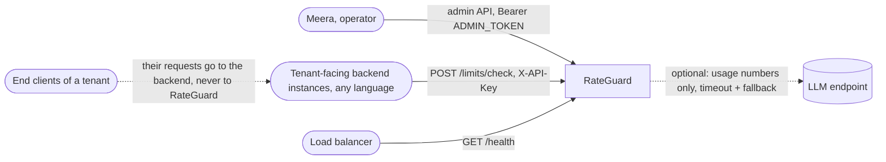
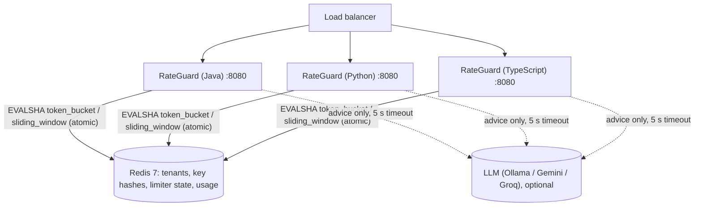
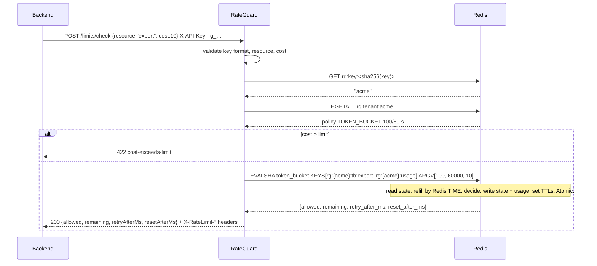

# RateGuard architecture

> Reference version (tag `phase-2-end`). Diagrams use [Mermaid](https://mermaid.js.org/).

## 1. Context diagram

RateGuard answers "may tenant X spend `cost` on `resource` now?". The caller enforces the answer;
only `/demo/hello` shows what an endpoint protected by RateGuard looks like.

## 2. Container diagram

* **On the request path:** Redis only. One check = key lookup + tenant read + one script call.
* **Off the request path:** the LLM (only `POST /advice`, admin only, falls back to rules).
* **Stateless app instances:** any instance (in any language) can answer any request, because all
  state is in Redis and the scripts are shared (`spec/lua/`).

## 3. Check sequence

**Two instances racing for the last token:** both send `EVALSHA` at the same moment. Redis runs
scripts one after the other, so the first sees 1 token and takes it, the second sees 0 and is
denied. No locks, no retries, one round trip each (ADR-0001).

## 4. Algorithms
| | Token bucket | Sliding window counter |
|---|---|---|
| State per tenant + resource | `tokens` (float), `ts` (ms) | window index `w`, `cur`, `prev` |
| Rule | refill `(now - ts) × limit / window`, cap at `limit`; allow if `tokens ≥ cost` | `estimate = prev × (window - elapsed) / window + cur`; allow if `estimate + cost ≤ limit` |
| Bursts | up to `limit` at once after an idle period, then a steady `limit / window` | never more than `limit` in any window, smooth |
| Exactness | exact | approximation: assumes the previous window's requests were spread evenly |
| `retryAfterMs` | time until `cost` tokens have refilled | time until enough of the old window has slid out |
| Memory | 2 fields | 3 fields |

Both are computed with integers where it matters (the sliding window multiplies everything by
`window_ms` so there is no rounding drift between Lua and the three languages). A fixed-window
counter (`INCR` + `EXPIRE`) was rejected: it admits up to `2 × limit` across a window boundary.

## 5. Redis key layout
| Key | Type | TTL | Content |
|---|---|---|---|
| `rg:tenants` | SET | none | all tenant ids (for `GET /admin/tenants`) |
| `rg:tenant:<id>` | HASH | none | id, name, algorithm, limit, windowSeconds, keyHash, keyPrefix, createdAt, updatedAt |
| `rg:key:<sha256(apiKey)>` | STRING | none | tenant id |
| `rg:{<id>}:tb:<resource>` | HASH | until the bucket is full again + 1 s | tokens, ts |
| `rg:{<id>}:sw:<resource>` | HASH | 2 windows + 1 s | w, cur, prev |
| `rg:{<id>}:usage` | HASH | 3 h | ring of 180 minutes: `m<slot>` (minute), `a<slot>` (allowed), `d<slot>` (denied) |

The `{<id>}` **hash tag** puts every key a script touches into the same Redis Cluster slot (ADR-0003).
Ids and resources use strict character sets, so input can never contain `{`, `}`, `*` or spaces.
Tenant creation starts with `SADD rg:tenants <id>`: Redis answers `0` when the id is already there,
so of two racing creates exactly one wins (then `MULTI`/`EXEC` writes the hash and the key lookup); `reset` and `delete` find limiter keys with `SCAN MATCH rg:{<id>}:*`, never `KEYS`.

## 6. Failure modes
| Failure | What a client sees (v1.0) | Why |
|---|---|---|
| Redis down (connection refused) | `503 limiter-unavailable`, `Retry-After: 1`; `/health` 503 | fail closed (ADR-0004) |
| Redis slow / frozen | the same, after `REDIS_TIMEOUT_MS` (1 s) | a timeout is a failure |
| Redis restarted without persistence | tenants gone: `401`; limiter state gone: full limits | the compose file enables AOF for tenants; limiter state is disposable by design |
| Scripts flushed (`SCRIPT FLUSH`, failover) | nothing: `NOSCRIPT` → the store reloads the script | |
| LLM down / slow / nonsense | advice from the rules, `fallback: true` | NFR-7 |
| A key leaked | nothing until the operator rotates; then `401` at once | FR-5 |

## 7. Key decisions
* [ADR-0001](adr/0001-atomic-lua-scripts-with-pure-function-twins.md): limiter decisions in atomic Lua scripts, with pure-function twins
* [ADR-0002](adr/0002-redis-time-as-the-only-clock.md): Redis TIME is the only clock
* [ADR-0003](adr/0003-hash-tags-in-limiter-keys.md): key layout with a `{tenantId}` hash tag
* [ADR-0004](adr/0004-fail-closed-when-redis-is-unavailable.md): fail closed (503) when Redis is unavailable
* [ADR-0005](adr/0005-hashed-api-keys-and-constant-time-admin-token.md): API keys stored as SHA-256, admin token compared in constant time

## 8. Contract map
| Endpoint | Requirement |
|---|---|
| `GET /health` | FR-15 |
| `POST /admin/tenants` | FR-1, FR-2, FR-3, FR-5 |
| `GET /admin/tenants`, `GET/DELETE /admin/tenants/{id}` | FR-1, FR-4 |
| `PUT /admin/tenants/{id}/policy` | FR-1, FR-3 |
| `POST /admin/tenants/{id}/rotate-key` | FR-1, FR-5 |
| `POST /admin/tenants/{id}/reset` | FR-1, FR-12 |
| `GET /admin/tenants/{id}/usage` | FR-1, FR-13 |
| `POST /admin/tenants/{id}/advice` | FR-1, FR-14 |
| `POST /limits/check` | FR-6 … FR-9, FR-11 |
| `GET /demo/hello` | FR-6, FR-10, FR-11 |
| every error | FR-16 |
